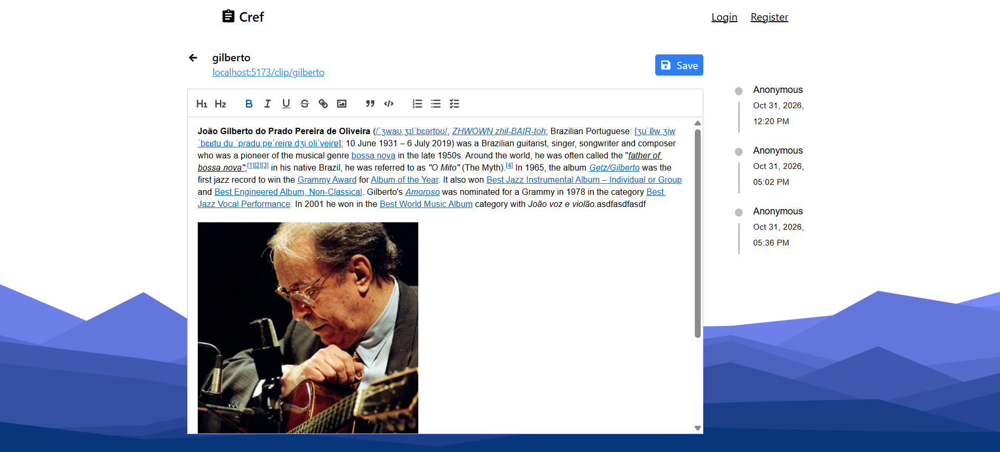

# Calmref

> Create, share, and edit rich-text snippets through simple public URLs. 

Every clip lives at a slug like `/clip/my-note`. Anyone with the link can open it. Signed-in users can own a clip, lock it as read-only, and view its edit history. Built with React + Vite, an `ASP.NET` Web API, and MySQL. Images are stored and served through ImageKit.io.

---

## 

## Features

**Clips**

- Shareable slug-based URLs (`/clip/my-note`)
- Rich text editing with Quill: formatting, links, lists, and code blocks
- Inline image upload via ImageKit.io
- Read-only protection for clips you own
- Editor activity history per clip

**Authentication**

- Email registration with OTP verification
- JWT bearer authentication
- Refresh tokens for persistent sessions

**Platform**

- Rate-limited image upload authentication
- CORS configured for local frontend development
- Unit-tested backend services

---

## Tech Stack

**Frontend**

- React 19, TypeScript, Vite
- Tailwind CSS, Material UI
- React Router
- Quill rich text editor

**Backend**

- ASP&#46;NET Web API (.NET 10)
- Entity Framework Core
- MySQL
- JWT bearer authentication
- MailKit for email

**Services**

- ImageKit.io for image storage and CDN delivery

---

## Getting Started

#### Prerequisites

- Node.js v18+
- npm
- .NET 10 SDK
- MySQL
- SMTP credentials (for OTP emails)
- ImageKit.io account (for image uploads)

#### Installation

1. Clone the repo

```bash
   git clone https://github.com/yourname/calmref.git
```

2. Configure the backend (see [Configuration](#configuration))

3. Start the API

```bash
   cd calmref/calmref_server/calmref.Api
   dotnet restore
   dotnet run
```

4. Install and start the frontend

```bash
   cd calmref/calmref_client
   npm install
   npm run dev
```

5. Open `http://localhost:5173`

---

## Configuration

The server reads from `calmref_server/calmref.Api/appsettings.json` and environment values.

```json
{
  "ConnectionStrings": {
    "Default": "Server=localhost;Database=calmref;User=root;Password=your_password;"
  },
  "Application": {
    "Issuer": "calmref",
    "Audience": "calmref-client",
    "Token": "replace-with-a-strong-secret"
  },
  "Smtp": {
    "Host": "smtp.gmail.com",
    "Port": 587,
    "User": "your_email@gmail.com",
    "Password": "your_app_password"
  },
  "IMAGEKIT_PRIVATE_KEY": "your_imagekit_private_key"
}
```

Avoid committing real secrets. Use .NET user secrets for local development:

```bash
   cd calmref_server/calmref.Api
   dotnet user-secrets init
   dotnet user-secrets set "Application:Token" "your-long-random-secret"
   dotnet user-secrets set "IMAGEKIT_PRIVATE_KEY" "your_imagekit_private_key"
```

---

## License

This project is licensed under the [MIT License](LICENSE).